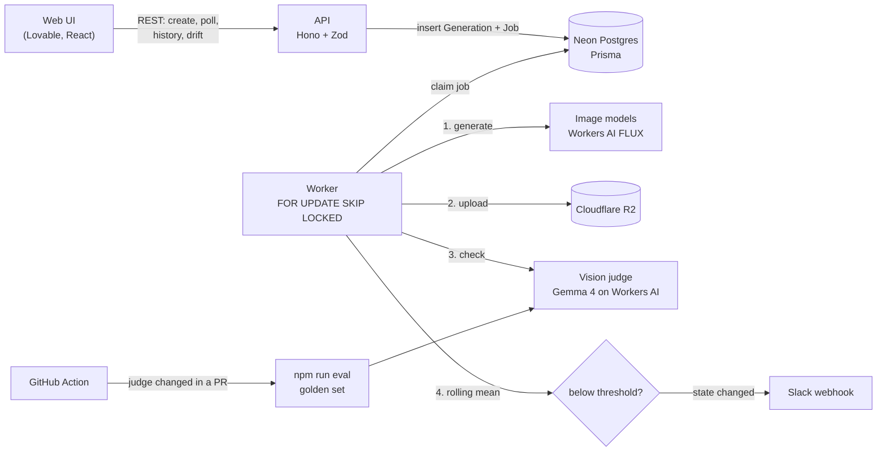

# StyleGuard

Generating one on-brand image is easy. Generating hundreds and noticing when they quietly stop looking like the brand is the hard part. StyleGuard is a small tool for that: it generates images from brand templates, has a vision model check every result against the brand rules, keeps versions of everything, and tells you in Slack when a brand starts drifting.

- Live demo: https://styleguardtest.lovable.app
- API: https://styleguard-api.onrender.com (free instance, the first request after a while can take up to a minute)
- Frontend code: https://github.com/yuliiastanenko/styleguardtest

## What it does

- **Brands with versions.** A brand is a style prompt, written rules, a palette and a pass threshold. Editing a brand never overwrites it, it creates a new version, and every image remembers which version it was made with.
- **Generation through a queue.** `POST /generations` returns right away, a worker does the rest: generate, upload to R2, check, done. The UI polls and shows each step.
- **A judge on every image.** A vision model scores the image 0 to 10 against the brand rules and explains why. Whether that counts as on-brand is decided in code from the brand's threshold, not by the model.
- **Model comparison.** Same brand and subject through two models side by side, with score, latency and cost.
- **Drift alerts.** A rolling average of scores per brand and model. When it falls below the threshold, one Slack message. When it recovers, another one.
- **An eval for the judge itself**, with a hand-labelled set and a GitHub Action that reruns it whenever the judge changes.

## Architecture



The API and the worker are two entry points in the same codebase (`src/index.ts` and `src/worker.ts`). On the free Render plan there is only one process, so the worker runs inside the API with `RUN_WORKER=true`. With a paid plan they'd be two services and nothing in the code changes.

Stack: Hono, TypeScript, Prisma, Neon Postgres, Cloudflare R2, Cloudflare Workers AI (FLUX for images, Gemma 4 and Llama 4 Scout as judges), Zod everywhere input comes in, Render for hosting, Lovable for the UI.

## Decisions and why

**The queue lives in Postgres.** Jobs are claimed with `UPDATE ... WHERE id = (SELECT ... FOR UPDATE SKIP LOCKED)`, so several workers never take the same job. I didn't add Redis or BullMQ because the database was already there and the load is tiny. If a worker dies mid job, its lock goes stale after 10 minutes and another worker picks the job up.

**Retries only when they can help.** Timeouts, 429 and 5xx get exponential backoff with jitter (5s, 10s, 20s, max 3 attempts). A 400 or a missing key fails right away, retrying it would just cost money. Each stage checks what's already saved, so a retry after a failed check doesn't generate a new image. Uploads use the generation id as the R2 key, so a repeated upload overwrites instead of duplicating.

**Idempotency.** `POST /generations` takes an `Idempotency-Key` header with a unique index behind it. Double clicks and client retries return the same generation instead of making a second one.

**Brand versions are immutable.** An edit inserts version + 1. Old images keep pointing at the rules they were judged by, so an old "7 / 10, on-brand" still means what it meant. An edit that changes nothing doesn't create a version.

**The judge scores, the code decides.** The model never sees the threshold. It returns `{ score, paletteMatch, reasons }`, Zod validates it, and `onBrand = score >= threshold` happens in code. Changing a threshold doesn't require asking the model again.

**No invented scores.** If the judge returns something that isn't valid JSON or doesn't fit the schema, it gets one retry with a nudge. After that the image is saved with `check_unavailable` and the score stays null. If the judge service is down on the last attempt, the image is still kept, it's just unchecked.

**Everything that affects a result is stored with it**: brand version, prompt template version, model, seed (where the model supports one), latency, cost, judge model and judge prompt version. Without that, comparing results over time doesn't mean much.

**New model = one line.** Models live in a registry (`src/providers/models.ts`) with provider, endpoint and price. There are adapters for Workers AI, fal and OpenAI, the UI only lists models whose provider has a key configured.

**Cloudflare Workers AI** because I wanted the whole thing to run for close to nothing. Generation and judging both run there, the R2 bucket is in the same account.

**Spend guard.** The demo is public, so `POST /generations` is capped at 50 images a day for the whole site and 10 per 10 minutes per IP. 50 a day stays inside Cloudflare's free daily allocation.

## Evaluating the judge

The whole tool depends on the judge, so I wanted numbers for how much to trust it.

**Golden set.** 42 images, 14 per brand, of three kinds: subjects that fit the brand, the brand's style with a subject that pulls against it (fireworks for a calm Nordic brand), and images rendered in another brand's style. I labelled them myself on a small labelling page that only shows the image and the brand rules, not the kind or any score. 26 ended up on-brand and 16 off-brand. Some "pulling" subjects still came out on-brand, the generator held the style better than I expected, so I labelled them as on.

**Metrics.** `npm run eval` runs a judge over the set and reports agreement with my labels, precision and recall for off-brand (that's the class we need to catch), AUC as a threshold-free check of whether scores separate good from bad at all, and stability: 10 images are judged 5 times each to see how much the score moves and whether the verdict ever flips. Results are cached per judge and a hash of the judge code, so an interrupted run continues where it stopped.

**Results**

| Judge | Prompt | Agreement | Precision (off) | Recall (off) | AUC | Mean score on / off | Score σ | Verdict flips | Latency |
|---|---|---|---|---|---|---|---|---|---|
| Gemma 4 26B | j1 | **93%** | **84%** | 100% | **0.99** | 9.2 / 1.9 | 0.07 | 0/10 | 14.3 s |
| Gemma 4 26B | j2 | 90% | 80% | 100% | 0.99 | 9.2 / 1.8 | 0.13 | 0/10 | 15.1 s |
| Llama 4 Scout | j1 | 79% | 64% | 100% | 0.96 | 6.7 / 2.1 | 0.00 | 0/10 | 8.2 s |
| Llama 4 Scout | j2 | 79% | 64% | 100% | 0.98 | 7.4 / 2.1 | 0.00 | 0/10 | 6.1 s |

What I took from it:

- **Both judges caught every off-brand image.** All the mistakes go the same way: the judge is stricter than me. For a quality gate that's the side I'd rather be wrong on.
- **Llama's problem is the scale, not the eye.** AUC 0.96 means it ranks images almost as well as Gemma, but it scores clean on-brand images around 7, right under the 7 to 7.5 brand thresholds. Thresholds are therefore tied to the judge. Switching judges means recalibrating, which is exactly why the eval runs on every judge change, and why drift only compares scores from the same judge and prompt.
- **Gemma's three misses are worth reading.** One is 7 against a threshold of 7.5 (I raised Nordic's threshold in v2, under v1 it would have passed). One is a fast food tray with a plastic cup that I called on-brand, while Terra's rules literally say "no plastic". The judge has a point there.
- **j2 didn't earn its place.** I tried explicit score anchors ("9 to 10 means it follows every rule"). Llama's on-brand scores went up from 6.7 to 7.4 and AUC improved, but agreement didn't move, and Gemma lost one image. On 42 images one image is 2.4 points, so that's noise, not a regression, but it isn't an improvement either, so j1 stays. The PR with the numbers is closed, not merged.
- **I picked Gemma** despite it being slower (14 s vs 8 s per check). Generation is async behind a queue and the UI shows progress, so the extra seconds barely show. A wrong verdict shows.

**CI.** `.github/workflows/judge-eval.yml` runs on any PR that touches the judge, its prompt, the eval scripts or the golden set. It runs both judges, comments the table on the PR and commits the raw results to the branch, so merging a judge change also merges the evidence for it.

## Drift

After every successful check the worker takes the last 10 scores for that brand and model and compares the mean to the brand threshold. Below it, the pair switches to "drifting" and Slack gets one message. It switches back only once the mean is half a point above the threshold, so an average sitting right on the line doesn't send a message on every image. The status switch is a conditional update, so two workers finishing at the same moment can't both send the alert. The Drift page in the UI shows the rolling mean against the threshold for each brand and model.

`npm run drift:demo -- --api <url> --brand nordic` pushes a brand into drift on purpose with six off-brand subjects, handy for checking the Slack setup.

## Running it locally

You need Node 22, a Neon (or any Postgres) database, an R2 bucket and a Cloudflare API token with Workers AI access.

```bash
npm install
cp apps/api/.env.example apps/api/.env   # fill in the values
npm run db:migrate
npm run db:seed                          # three example brands

npm run dev:api                          # terminal 1
npm run dev:worker                       # terminal 2
```

Useful scripts:

| Command | What it does |
|---|---|
| `npm run gen:test -- cf-flux-schnell "a cup"` | one generation straight through a provider, no queue |
| `npm run judge:test -- <generationId>` | judge one stored image and print the verdict |
| `npm run eval:build` | generate the eval image set |
| `npm run eval:label` | build the labelling page `eval/label.html` |
| `npm run eval -- --judge cf-gemma4,cf-llama4-scout` | run the eval |
| `npm run drift:demo -- --brand nordic` | force a drift alert |

API reference: [docs/api.md](docs/api.md).

## Layout

```
apps/api/
  src/
    routes/       health, models, brands, generations, drift
    providers/    image model registry and adapters (Workers AI, fal, OpenAI)
    judge/        judge prompt, judge registry, call + validation
    pipeline/     queue, worker loop, generation stages
    drift/        rolling mean, state changes, Slack
    lib/          validation, errors, limits
  prisma/         schema, migrations, seed
  scripts/        eval, test and demo scripts
eval/             subjects, dataset, my labels, cached runs, results
docs/api.md
```

## Costs

Everything runs on free tiers except Cloudflare Workers Paid ($5 a month), which I turned on to get through the eval in one day instead of three. The eval itself cost well under a dollar on top of that. In normal use one generation plus one check is roughly $0.003 at list price, and the daily cap keeps the demo inside the free allocation.

## What I'd do next

- **A bigger golden set with a second labeller.** 42 images and one person is enough to compare judges, not enough to trust a single percentage. Inter-annotator agreement would also show how subjective "on-brand" is to begin with.
- **Per-judge thresholds**, calibrated from the eval, instead of one threshold per brand that silently assumes Gemma's scale.
- **Reference images instead of only text rules.** Most real brand guides are visual. Scoring against a few approved examples is probably closer to how a designer judges.
- **A measured palette score.** `paletteMatch` comes from the model today. Dominant colours from the pixels compared to the palette would be cheaper and deterministic.
- **Real cost tracking** from provider usage instead of list prices.
- **Auth and per-user quotas**, and a shared store for rate limits once there's more than one instance.
